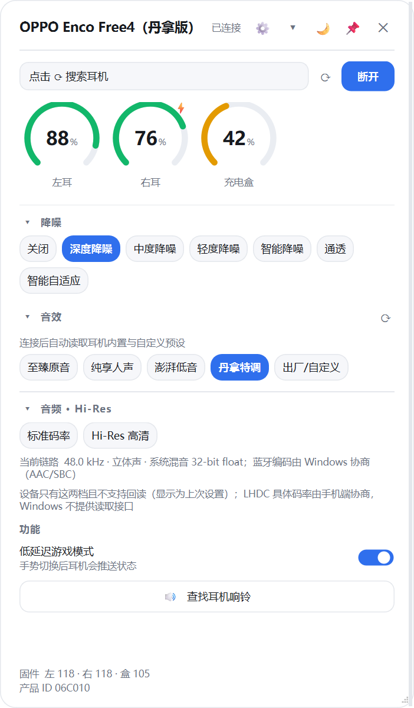

# OPPO Enco Controller（Windows）

Windows 上的 OPPO / OnePlus 真无线耳机控制台，**优先适配 OPPO Enco Free4 / Free4 丹拿版**。
无需手机，直接通过蓝牙私有协议控制降噪、音效、Hi-Res 等。



绿色单文件 EXE，拷走即用，不需要 Python、不需要驱动 → [下载最新版](https://github.com/biu-ykxl/oppo-enco-controller/releases/latest)

## 功能

| 功能 | 协议 | 状态 |
|---|---|---|
| 电量（双耳 + 充电盒，含充电状态） | `0x0106` + 推送 | 真机验证 |
| 降噪切换（关/深度/中度/轻度/智能/通透/自适应） | `0x0404` / `0x010C` | 真机验证 |
| 音效预设（自动读取耳机内全部预设，含自定义） | `0x0122` / `0x0406` / `0x010F` | 真机验证 |
| Hi-Res / 码率档位（标准 / 高清） | `0x0403` feature `0x18` | 真机验证 |
| 低延迟游戏模式 | `0x0403` feature `0x06` | 真机验证 |
| 查找耳机响铃 | `0x0400` | 真机验证 |
| 佩戴 / 在盒状态 | 推送事件 `0x0204#2` | 真机验证 |
| 双连设备列表 | 推送事件 `0x0204#0xF2` | 真机验证 |
| 固件版本 | `0x0105` | 真机验证 |
| 最小化为条状（可自定义显示项） | — | — |
| 日志落盘（可选详细协议帧） | — | — |
| 窗口置顶、深浅主题 | — | — |

## 使用

### 直接跑 EXE

1. 在 Windows 蓝牙设置里**配对并连接**耳机；
2. 手机端欢律 App 断开该耳机（RFCOMM 同时只允许一个客户端）；
3. 运行 `OppoEncoController.exe`，刷新 → 选择设备 → 连接。

要求 64 位 Windows 10/11。VC++ 运行库已打进 EXE，无需安装。首次运行若被
SmartScreen 拦，选「更多信息 → 仍要运行」。

### 条状形态（最小化）

点标题栏的 **▾** 收成一条长方形横条：左边连接指示灯与耳机名，中间是**降噪下拉**
（点开直接选档位，不占宽度），右边是电量与常用按钮；**▴** 展开回完整面板。


显示哪些内容可在 **⚙ → 条状形态显示** 里自定义（降噪切换 / 电量 / 游戏模式 /
查找耳机），选择会被记住。条状形态与深色模式同样会记忆。

### 日志

所有会话与命令都写入 `%LOCALAPPDATA%\OppoEncoController\logs\app-<时间>.log`，
只保留最近 10 个。**⚙ → 详细协议日志** 打开后额外记录每一帧收发的十六进制原文，
排障时很有用；**⚙ → 打开日志文件夹** 直接定位。也可以用 `python app.py --verbose`
以详细模式启动。

### 源码运行

```
pip install -r requirements.txt
python app.py          # 界面
python app.py --demo   # 无耳机预览界面
```

### 打包

```
build.bat              # 或 python -m PyInstaller OppoEncoCC.spec --noconfirm
```

### 诊断工具

```
python probe.py                                # 列出已配对蓝牙设备
python probe.py 00:AA:BB:CC:DD:EE              # 连接并 dump 全部命令回复
python probe.py 00:AA:BB:CC:DD:EE anc 4        # 设降噪（叶子档位 ID）
python probe.py 00:AA:BB:CC:DD:EE eqall        # 读 EQ 目录（含自定义预设）
python probe.py 00:AA:BB:CC:DD:EE feat 0x18 on # 功能开关
python probe.py 00:AA:BB:CC:DD:EE ancmodes     # 设备自报支持的降噪档位
python probe.py 00:AA:BB:CC:DD:EE watch        # 持续监听推送
```

## 协议要点

私有协议与欢律 App（HeyMelody）同源：**OPOv1 over RFCOMM**，
帧格式 `AA | varint 长度 | 00 00 | 命令 LE16 | seq | 载荷长度 LE16 | 载荷`。

真机踩出来的关键点（原始报文见 [docs/VERIFIED.md](docs/VERIFIED.md)）：

- **通道 15**，且连上后必须发一次电量查询、收到 `0x8106` 才算对上控制通道 ——
  RFCOMM 上还有 HFP/AVRCP 服务，光「能连上」会误判（曾连到通道 3，命令全部超时）。
- **降噪用叶子档位 ID**（3=关、4=深度、5=中度、6=轻度、7=智能、8=通透、11=自适应），
  白名单里的 group index（0/1/2）会被设备乱映射；`0x8404` 的 ack 恒为 00，必须回读 `0x010C`。
- **`0x0403` 第二个字节是「值」不是布尔**：Hi-Res（feature `0x18`）用 `2=开、0=关`，
  发 `1` 或 `3` 会让耳机直接断开链路；游戏模式（feature `0x06`）才是 `1/0`。
- **`0x0122` 只返回具名/自定义预设**，内置 0~3 不在列表里，界面已做合并。
- **码率读不到**：扫遍设备声明的 25 个查询命令都没有编码/码率返回，Windows 也不暴露
  A2DP codec；界面显示的是 Core Audio 混音格式（`GetMixFormat`），不是蓝牙码率。
- **档位可以问设备**：`0x010C` 带 `03 01` 会返回支持档位的位图，界面优先用它生成
  降噪按钮 —— 白名单没收录的 realme / 新型号因此也能用。

## 支持范围

已在 **OPPO Enco Free4 丹拿版**（产品 ID `06C010`）上逐条验证。
Free4（`068C10`）、Free3、Air4、Air3 等按同一套白名单能力表内置，
**未逐一真机验证**。

**realme / OnePlus / 未收录型号**：realme 与 OPPO 同属欢律协议族，走「通用档位 +
运行时发现」（`0x010C 03 01`），按蓝牙名 `realme` 识别。这类型号降噪切换采用
乐观更新、不等回读（Air 系列同样处理），避免固件响应慢导致手感发滞。

## 目录结构

```
app.py              界面与会话线程
probe.py            命令行抓包 / 诊断
oppo/protocol.py    帧编解码、命令表、载荷解析器
oppo/transport.py   RFCOMM 传输、通道探测与校验、通知订阅
oppo/devices.py     型号能力表（ANC 档位 / EQ 预设）
oppo/ui.py          自绘组件（电量环、拨动开关）与主题
oppo/btwin.py       Windows 蓝牙设备枚举
oppo/audioinfo.py   读取 Windows 输出格式（Core Audio）
oppo/logs.py        日志落盘与详细协议帧开关
docs/               真机验证记录、截图
```

## 致谢与许可

协议层的公开依据：

- [chiragverma11/melodyctl](https://github.com/chiragverma11/melodyctl)（MIT）—— 命令表与解码器
- [Swastik36/OPPO-Earbuds](https://github.com/Swastik36/OPPO-Earbuds) —— OPO v1 协议规范
- 欢律 App 的 `compatWhiteList` 型号能力矩阵

界面形态参考 [NobleS205/vivotwscontrollerforwin11](https://github.com/NobleS205/vivotwscontrollerforwin11)。

本项目以 **GPL-3.0** 发布（见 [LICENSE](LICENSE)），与 OPPO / OnePlus / 欢太无关，
仅供学习与个人使用，风险自负。

### 第三方许可

`oppo/protocol.py` 与 `oppo/transport.py` 的命令表、解码器移植自 melodyctl：

```
MIT License

Copyright (c) 2026 Chirag Verma

Permission is hereby granted, free of charge, to any person obtaining a copy
of this software and associated documentation files (the "Software"), to deal
in the Software without restriction, including without limitation the rights
to use, copy, modify, merge, publish, distribute, sublicense, and/or sell
copies of the Software, and to permit persons to whom the Software is
furnished to do so, subject to the following conditions:

The above copyright notice and this permission notice shall be included in all
copies or substantial portions of the Software.

THE SOFTWARE IS PROVIDED "AS IS", WITHOUT WARRANTY OF ANY KIND, EXPRESS OR
IMPLIED, INCLUDING BUT NOT LIMITED TO THE WARRANTIES OF MERCHANTABILITY,
FITNESS FOR A PARTICULAR PURPOSE AND NONINFRINGEMENT. IN NO EVENT SHALL THE
AUTHORS OR COPYRIGHT HOLDERS BE LIABLE FOR ANY CLAIM, DAMAGES OR OTHER
LIABILITY, WHETHER IN AN ACTION OF CONTRACT, TORT OR OTHERWISE, ARISING FROM,
OUT OF OR IN CONNECTION WITH THE SOFTWARE OR THE USE OR OTHER DEALINGS IN THE
SOFTWARE.
```
